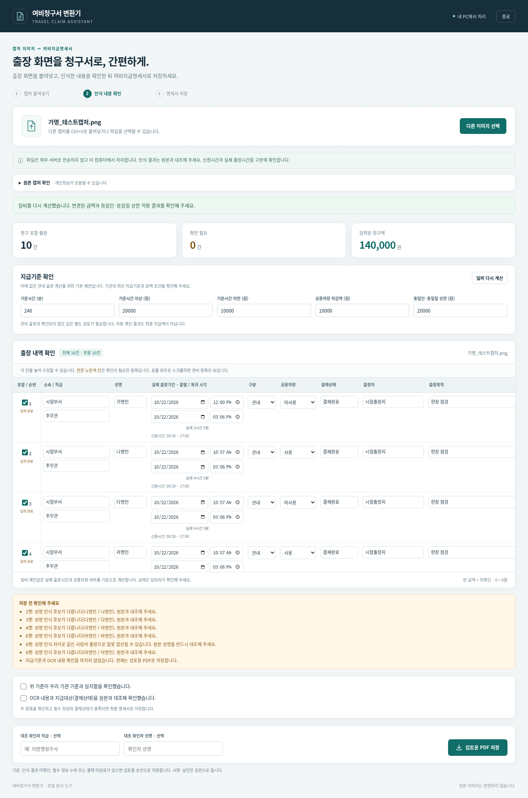

# 캡처에서 여비지급명세서로

근무지내출장처리 목록의 화면 캡처를 **오프라인 OCR → 담당자 검토 → 여비지급명세서 PDF**로 바꾸는 Windows 프로그램입니다. AI는 Tesseract LSTM 문자 인식에 사용하며, 금액 계산과 PDF 생성은 명시적인 규칙으로 처리합니다.

## Windows 프로그램 다운로드

**[여비청구서 변환기 ZIP 다운로드](https://github.com/himmelzu/ai/raw/refs/heads/main/downloads/TravelClaim-Windows.zip)** · 약 100MB · Windows 10/11 64비트

1. ZIP을 내려받아 압축을 풉니다.
2. `여비청구서변환기.exe`를 실행합니다. Python 설치는 필요하지 않습니다.
3. 자동으로 열린 브라우저 화면에 출장 목록 캡처를 붙여넣거나 이미지 파일을 선택합니다.
4. 인식한 이름·날짜·실제 시각·차량·결재상태를 확인하고, 지급기준 확인 및 일비 재계산 후 PDF를 저장합니다.
5. 사용이 끝나면 프로그램 화면의 **종료**를 누릅니다.

[상세 사용설명서](docs/사용설명서.md) · [예시 출력 PDF](downloads/example-statement.pdf) · [가명 테스트 캡처](downloads/example-capture.png) · [공모전 제안서 초안 PDF](downloads/contest-proposal.pdf)

자동 테스트 30개와 Windows 실행파일의 Wine 통합검증을 통과한 초기 실행판입니다. 실제 Windows PC에서의 기본 브라우저 연동은 별도 확인이 필요합니다. OCR 내용과 소속 기관의 지급기준을 확인한 뒤 사용하세요. 자료는 외부 AI 서비스로 전송하지 않습니다. 예시는 가명 자료입니다.



### 복사·수정할 수 있는 제안서

**[제안서 Word(DOCX) 다운로드](https://github.com/himmelzu/ai/raw/refs/heads/main/downloads/contest-proposal.docx)** · **[복사용 텍스트(TXT) 다운로드](https://github.com/himmelzu/ai/raw/refs/heads/main/downloads/contest-proposal.txt)**

DOCX는 이미지 대신 일반 문단과 표로 작성했습니다. 개인 참가정보·동의·서명은 직접 작성해야 합니다. `scripts/create_proposal_docs.py`로 다시 만들 수 있으며, 문서 생성에만 `python-docx==1.2.0`이 필요합니다.

배포 ZIP에는 실행파일, 사용설명서, 예시, 제안서 초안, 소스와 라이선스가 포함되어 있습니다. [SHA256 체크섬](downloads/SHA256SUMS.txt)으로 파일을 확인할 수 있습니다.

## 개발 실행

Python 3.12, Tesseract 5.x가 필요합니다. 아래 명령은 이 저장소에서 실행합니다.

```sh
python -m venv .venv
.venv/bin/python -m pip install -r requirements.txt zstandard==0.25.0
.venv/bin/python scripts/prepare_ocr.py --models-only --linux-smoke
.venv/bin/python app/backend.py --desktop
```

Windows용 OCR를 준비하고 EXE를 재현하려면 Linux에서:

```sh
.venv/bin/python scripts/prepare_ocr.py
.venv/bin/python scripts/build_windows.py
```

외부 다운로드는 빌드 단계에만 필요합니다. 공식 NuGet/PyPI/Go/conda-forge/모델 저장소의 고정 버전과 체크섬을 검증합니다. 빌드 도구용 `zstandard`는 최종 앱에 포함되지 않습니다. Windows 실행 파일은 Python/OCR/한국어 글꼴을 포함하며 실행 시 외부 서버를 호출하지 않습니다.

명령행 변환은 검토용 PDF를 생성합니다.

```sh
.venv/bin/python app/backend.py --convert capture.png --output statement.pdf
.venv/bin/python -m unittest discover -s tests -v
```

## 범위

- 지원 대상: 열 제목과 표가 보이는 근무지내출장처리 목록의 화면 캡처. 모든 문서 사진·손글씨를 지원하는 범용 문서 인식기는 아닙니다.
- 실제 확인시각을 읽으며 신청시각으로 대체하지 않습니다. 실제 날짜가 따로 표시되지 않는 해당 화면에서는 신청기간의 날짜를 사용하므로 날짜도 확인해야 합니다.
- 사번은 출력에서 제외합니다. 미신청·취소·반려 등은 청구 대상에서 기본 제외합니다.
- 기본 지급기준은 첨부 명세서 사례에 맞춘 예시입니다. 기관 기준을 확인하고 수정해야 합니다. 관외·여러 날 출장은 일비 자동계산 대상이 아닙니다.
- 미확인 내용이 있으면 검토용 PDF로 표시합니다. 서명이나 대조 완료를 프로그램이 대신 인증하지 않습니다.
- 실데이터는 소스나 EXE에 포함하지 않습니다. 테스트 자료는 가명입니다.

빌드 산출물과 큰 캐시는 `.build/`, `dist/`, `launcher/payload.zip`에 있습니다. 원본 첨부 문서와 실제 직원 정보는 배포 대상이 아닙니다.

## 라이선스

프로그램 소스는 AGPL-3.0-or-later입니다. 포함 구성요소의 별도 라이선스는 [THIRD_PARTY_NOTICES.md](THIRD_PARTY_NOTICES.md)와 배포 파일의 라이선스 폴더를 참고하세요.
